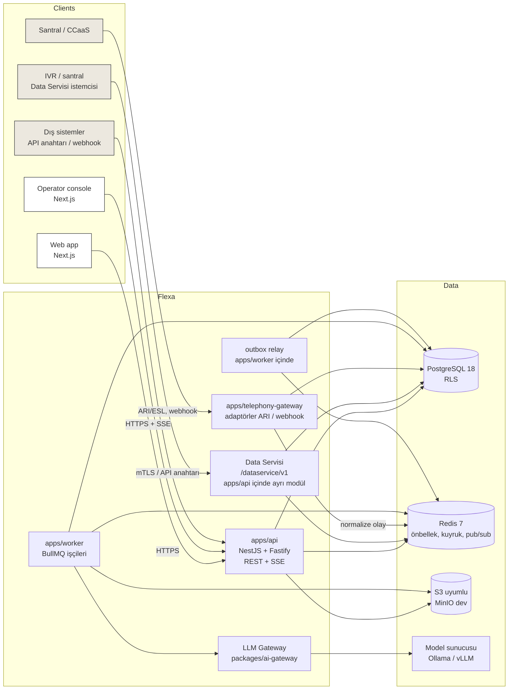
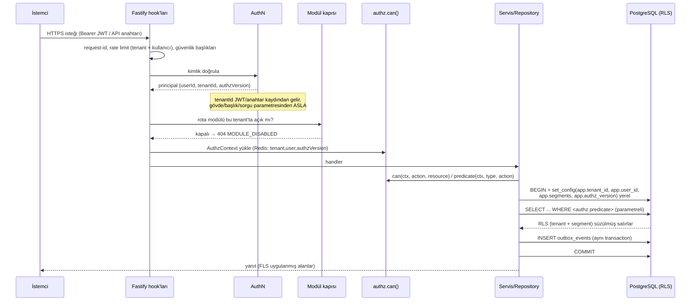

# Flexa Mimari Dokümanı

> Durum: **Faz 0 + G0 çıktısı (taslak, onay bekliyor)** · Tarih: 2026-11-20
> Kaynak gereksinimler: `CRM_TASK_PLATFORM_PROMPT.md` (Bölüm 1–12). Kararların gerekçeleri `docs/adr/` altındadır.

## 1. Sistem bağlamı



## 2. Teknoloji kararları (özet)

| Katman | Karar | ADR |
|---|---|---|
| Monorepo | pnpm workspaces + Turborepo, TypeScript 5.x `strict`, Node 24 LTS | 0001 |
| API | **NestJS 11 + Fastify adaptörü**; Zod sözleşmeleri → OpenAPI 3.1 (`/docs`) | 0001, 0012 |
| Web | Next.js (App Router), Tailwind, shadcn/ui, TanStack Query/Table, dnd-kit, Framer Motion | 0001 |
| ORM | **Drizzle ORM** + elle yazılmış SQL migration'ları (RLS, trigger, fonksiyon) | 0002 |
| DB | **PostgreSQL 18** (yerel `uuidv7()`, RLS, JSONB, FTS, `pg_trgm`, `unaccent`) | 0002 |
| Kuyruk | Redis 7 + BullMQ; tenant'a bölünmüş adil kuyruk | 0006, 0014 |
| Olay yolu | Transactional outbox → relay → BullMQ | 0006 |
| Gerçek zamanlı | **SSE** (Last-Event-ID ile yeniden oynatma) + Redis pub/sub fan-out; softphone medyası SIP/WSS (WebRTC) doğrudan santrale | 0007 |
| Kimlik | argon2id, kısa ömürlü erişim JWT (EdDSA, 10 dk) + httpOnly döner refresh çerezi, TOTP, OIDC (openid-client), SAML (G1) | 0009 |
| Yetki | Merkezi motor `can()` + aynı kuraldan SQL predicate; RLS son savunma hattı | 0004 |
| Sorgu dili | **RQL** (Flexa Query Language): el yazımı lexer/parser → AST → parametreli SQL | 0008 |
| Dosya | S3 uyumlu (MinIO dev), imzalı URL, tenant ön eki | 0013 |
| Gözlemlenebilirlik | Pino, OpenTelemetry (OTLP), `/healthz`, `/readyz` | 0001 |
| Test | Vitest, Testcontainers (PG + Redis), Playwright, fast-check (property/fuzz), k6 | 0001 |
| Telefoni | `TelephonyProvider` arayüzü; ilk adaptörler Asterisk ARI + genel webhook CCaaS; simülatör | 0015 |
| AI | `packages/ai-gateway` (OpenAI uyumlu iç arayüz); model seçimi G11'de ADR ile | 0022 |

## 3. Monorepo yapısı

```text
flexa/
├─ apps/
│  ├─ api/                    # NestJS + Fastify: REST, SSE, Data Servisi, OpenAPI
│  │  └─ src/modules/<modül>/ # her iş modülü: controller, service, repository, dto (zod)
│  ├─ worker/                 # BullMQ işçileri, outbox relay, zamanlanmış işler, SLA, AI işleri
│  ├─ telephony-gateway/      # santral bağlantıları (ARI/ESL websocket'leri, webhook alıcıları)
│  ├─ web/                    # tenant kullanıcı arayüzü (Next.js)
│  └─ operator/               # Platform Operatörü konsolu (ayrı alan adı, ayrı oturum)
├─ packages/
│  ├─ db/                     # Drizzle şeması, SQL migration'ları, RLS politikaları, seed
│  ├─ contracts/              # Zod şemaları (API girdi/çıktı), OpenAPI üretimi, hata kodları
│  ├─ authz/                  # can(), predicate üretici, kapsam çözümleme, alan politikası
│  ├─ modules/                # modül manifestleri, kayıt defteri, bağımlılık grafiği
│  ├─ config/                 # env doğrulama (Zod), katmanlı yapılandırma, JSON Schema'lar
│  ├─ security/               # argon2id, JWT (EdDSA), TOTP, zarf şifreleme, CSRF (P1'de eklendi)
│  ├─ events/                 # olay kataloğu tipleri, outbox yazıcı, olay zarfı
│  ├─ query-lang/             # RQL lexer, parser, AST, SQL derleyici
│  ├─ formula/                # güvenli formül değerlendirici (custom field)
│  ├─ workflow/               # durum makinesi motoru
│  ├─ automation/             # kural motoru (trigger → koşul → aksiyon)
│  ├─ sla/                    # çalışma saati / tatil / milestone hesaplayıcı
│  ├─ telephony/              # TelephonyProvider, normalize olay şeması, adaptörler, simülatör
│  ├─ ai-gateway/             # LLM Gateway, temizleyici, doğrulayıcı, adaptörler
│  ├─ i18n/                   # ICU mesajları (tr, en), eksik çeviri denetimi
│  ├─ ui/                     # tasarım sistemi; tokens.json → CSS değişkenleri → Tailwind preset
│  ├─ brand/                  # logo SVG'leri, favicon, PWA ikonları
│  └─ test-utils/             # Testcontainers kurulumları, tenant fabrikaları, matris test üretici
├─ docs/                      # ADR, mimari, ER, API, olaylar, riskler, varsayımlar, ilerleme
├─ infra/                     # docker-compose, Dockerfile'lar, örnek üretim (Compose/Helm)
└─ scripts/                   # contrast-report, matris→test üretimi vb. yardımcılar
```

**Modül sınırı kuralları**

1. `apps/*` birbirini import etmez; ortak kod `packages/*` içindedir.
2. Veritabanına yalnızca `packages/db` üzerinden erişilir; bir modül başka modülün tablosuna **yazmaz**, yalnızca o modülün servis arayüzünü çağırır veya olayına abone olur.
3. Yetki kararı yalnızca `packages/authz` üzerinden verilir (yeni yetki mantığı başka yerde yazılmaz).
4. Bir modülün API rotaları, menü öğeleri, izinleri ve işleri yalnızca manifestinde bildirilir (`packages/modules`), modül kapısı merkezi olarak uygular.

## 4. İstek yaşam döngüsü (tenant bağlamı ve yetki)



- **İki katmanlı savunma:** (1) uygulama katmanı `authz` predicate'i (kapsam, rol, alan), (2) veritabanı RLS (tenant + segment). Kapsam (kendi/ekip/kuyruk) RLS'te değil predicate'te uygulanır; tenant ve segment **her iki katmanda** da uygulanır.
- **Transaction başına bağlam:** `set_config(..., true)` (= `SET LOCAL`); bağlantı havuzuna sızmaz. Bağlam ayarlanmadan çalıştırılan sorgu RLS politikası gereği **sıfır satır** döner (`current_setting('app.tenant_id', true)` NULL).

## 5. Veritabanı rolleri

| Rol | Kullanım | Özellik |
|---|---|---|
| `flexa_owner` | Migration'lar | Tabloların sahibi; uygulama asla bu rolle bağlanmaz |
| `flexa_app` | API ve worker iş işleme | `NOBYPASSRLS`, tablo sahibi değil, tüm tenant tablolarında `FORCE ROW LEVEL SECURITY` |
| `flexa_relay` | Outbox relay | `BYPASSRLS` ama yalnızca `outbox_events` üzerinde `SELECT, UPDATE` izni |
| (çözümleyiciler) | Kimlik/tenant çözümü | Ayrı rol yerine `app` şemasındaki dar kapsamlı `SECURITY DEFINER` fonksiyonları (`find_user_for_login`, `list_my_tenants`, `find_refresh_token`, `consume_email_token`, `find_invitation`, `resolve_sso_provider`, G7'de `resolve_tenant_by_did`); sahipleri `flexa_owner`, `flexa_app` yalnızca EXECUTE iznine sahip. Kullanıcıya bağlı olanlar parametre yerine `app.user_id()` kullanır (P1 kararı) |
| `flexa_platform` | Operatör konsolu | Tenant meta tabloları; tenant iş verisine erişimi yok (destek erişimi `support_access_grants` ile, süreli) |
| `flexa_readonly` | Raporlama read-replica | Salt okuma, RLS açık |

## 6. Tenant'a bağlı olmayan (global) tablolar: kapalı liste

"Her tabloda `tenant_id`" kuralının **bilinçli ve kapalı** istisnaları (ADR-0003):

| Tablo | Neden global | Koruma |
|---|---|---|
| `tenants` | Tenant kaydının kendisi | RLS: `id = app.tenant_id` (uygulama), operatör rolü ayrı |
| `users`, `user_credentials`, `user_mfa`, `auth_sessions`, `refresh_tokens` | Bir kişi birden çok tenant'a üye olabilir (tenant seçimi akışı) | Uygulama rolü yalnızca kendi `app.user_id` satırını görür; giriş araması `find_user_for_login()` definer fonksiyonu |
| `platform_operators`, `operator_sessions` | Tenant dışı rol | Yalnızca `flexa_platform` |
| `plans` | Platform plan kataloğu | Salt okuma |
| `telephony_numbers` | DID → tenant çözümü tenant bilinmeden yapılır | Doğrudan erişim yok; `resolve_tenant_by_did()` |
| `ai_models` | Platform model kaydı | Salt okuma; tenant izni `ai_tenant_settings` (tenant'lı) |
| `outbox_events` | Relay tüm tenant'ları tarar | `tenant_id` sütunu **vardır** ve RLS açıktır; yalnızca relay rolü bypass eder |

Bu listeye ekleme yalnızca ADR ile yapılır; CI'daki `scripts/check-tenant-columns` (Faz 1) listede olmayan ve `tenant_id`/RLS içermeyen tabloyu reddeder.

## 7. Olay mimarisi

```text
Servis (tx) ─┬─ iş tablosu yazımı
             ├─ activity_events (append-only, timeline)
             └─ outbox_events (aynı tx)            ← en az bir kez teslim
                    │  relay: LISTEN/NOTIFY uyandırma + FOR UPDATE SKIP LOCKED
                    ▼
        BullMQ: events.<shard>  (tenant_id hash → shard, shard içinde tenant round-robin)
                    │
     ┌──────────────┼───────────────┬──────────────┬───────────────┐
     ▼              ▼               ▼              ▼               ▼
 otomasyon      bildirim/mention  webhook teslim  SSE fan-out    arama indeksi /
 motoru         (G6)              (HMAC, retry)   (Redis pub/sub) okuma modeli
```

- Olay zarfı: `{id(uuidv7), type, version, tenantId, occurredAt, actor, resource{type,id,segment}, causationId, correlationId, depth, payload}`. Katalog: `docs/events.md`.
- **İdempotency:** tüketici başına `processed_events(consumer, event_id)` benzersiz anahtarı; otomasyon için `automation_runs(rule_id, event_id, record_id)` benzersiz.
- **Döngü koruması:** `depth` (zincir derinliği, varsayılan max 5) + `causation` zincirinde aynı `rule_id` tekrar görülürse durdurma.
- **DLQ:** her kuyruk için `*.dlq`; `dead_letters` tablosuna da yazılır; replay aracı (Faz 5).

## 8. Yetki modeli (özet; ayrıntı ADR-0004)

```text
ERİŞİM = ModülAçık ∧ RolYetkisi(eylem) ∧ SegmentYetkisi ∧ KapsamEşleşmesi ∧ AlanPolitikası   (varsayılan: reddet)
```

- `AuthzContext` = {tenantId, userId, roleIds, permissions[modül.kaynak.eylem → kapsam], segments(etkin, süreli), teamIds (üye/yönetici), queueIds, roleHierarchyPath, fieldPolicies, enabledModules, authzVersion}.
- Önbellek: Redis `authz:{tenant}:{user}:{authzVersion}`; her yetki/ekip/segment/modül değişikliği `memberships.authz_version` değerini artırır, JWT'deki sürüm DB'deki sürümle eşleşmezse bağlam yeniden yüklenir → "en geç bir sonraki istek" (G2 kabul kriteri).
- `predicate(ctx, resourceType, action)` → Drizzle `SQL` parçası; liste, sayım, arama, rapor, export, SSE abonelik süzgeci, ekran açma ve Data Servisi **aynı fonksiyonu** kullanır.
- 404 / 403: kayıt predicate'e takılıyorsa **404** (varlık sızdırılmaz); görünür ama eylem yetkisizse **403**.
- Faz 4 RBAC'ı ile G2 yetki çekirdeği **tek motor olarak** inşa edilir (iki ayrı motor yazılmaz).

## 9. Segment modeli (ayrıntı ADR-0010)

- Kimlik tabloları (`accounts`, `contacts`): `segments segment[] NOT NULL` (bir kişi/firma iki segmentte olabilir, SEG-05).
- İşlem tabloları (`leads`, `opportunities`, `quotes`, `orders`, `returns`, `campaigns`, `calls`, …): `segment segment NOT NULL` (tek değer).
- `tasks`, `cases`, `notes`, `activity_events`: `segment segment NULL`; NULL = segmentten bağımsız (iç iş); ilişkili kayıttan türetilir.
- RLS: `segment IS NULL OR segment = ANY(app_segments())` / `segments && app_segments()`.
- Tenant satış modu `b2b_only` ise kullanıcı yetkisi ne olursa olsun etkin segment kümesi `{b2b}` ile kesişir.

## 10. Dağıtım topolojisi (Docker Compose)

| Servis | İmaj | Not |
|---|---|---|
| `postgres` | postgres:18 | init script'i rolleri oluşturur |
| `redis` | redis:7 | AOF açık (kuyruk dayanıklılığı) |
| `minio` | minio | dosyalar, çağrı kayıtları |
| `mailpit` | mailpit | geliştirme e-postası |
| `api` | `flexa-api` | yatay ölçeklenebilir, durumsuz |
| `worker` | `flexa-worker` | yatay ölçeklenebilir |
| `telephony-gateway` | `flexa-telephony` | `telephony` profili |
| `web`, `operator` | `flexa-web`, `flexa-operator` | |
| `otel-collector` | otel/opentelemetry-collector | isteğe bağlı `observability` profili |
| `ollama` / `vllm` | | `ai` profili (G11) |

## 11. Fonksiyonel olmayan hedefler ve nasıl kanıtlanacakları

| Hedef | Ölçüm yöntemi | Faz |
|---|---|---|
| Liste API p95 < 200 ms (10 bin kayıt, yetki predicate'li) | k6 + `EXPLAIN ANALYZE` çıktısı `docs/perf/` | 2, 4, 8 |
| Lookup p95 < 150 ms | k6, önbellekli | G7 |
| Bildirim uçtan uca p95 < 2 sn | OTel span'ları + sentetik istemci | G6 |
| Tenant/segment sızıntı = 0 | matris tabanlı üretilmiş test paketi | 1, G1, G2, G10 |
| Kanban optimistic < 100 ms | Playwright performans ölçümü | 6 |

## 12. İlgili dokümanlar

- ADR dizini: `docs/adr/README.md`
- ER diyagramı: `docs/er-diagram.md`
- API taslağı: `docs/api-draft.md`
- Olay kataloğu: `docs/events.md`
- Risk kaydı: `docs/risks.md`
- Varsayımlar: `docs/assumptions.md`
- Faz planı: `docs/phase-plan.md`
- Gereksinim analizi ve düzeltmeler: `docs/requirements-review.md`
- Kurumsal: `docs/enterprise/` (izlenebilirlik, kullanıcı hikâyeleri, yetki matrisi YAML, modül manifest şeması, wireframe'ler)
- Marka/token: `packages/ui/tokens.json`, `docs/contrast-report.md`
