# ER Diyagramı

> Faz 0 + G0 · 2026-11-20. Okunabilirlik için alanlara bölünmüştür. Tüm tenant tablolarında `tenant_id` (RLS, ADR-0003) ve ortak sütunlar (`created_at, updated_at, created_by, updated_by, version`; uygun tablolarda `deleted_at`, `archived_at`) **vardır ama tekrar yazılmamıştır**. `segment` / `segments` sütunları ADR-0010'a göredir. Polimorfik `related_type + related_id` → `record_registry` bileşik FK (ADR-0005).
> Global (tenant'sız) tablolar `docs/architecture.md` §6'daki kapalı listededir ve diyagramlarda **[G]** ile işaretlidir.

## 1. Tenant, kimlik ve platform

```mermaid
erDiagram
  tenants ||--o{ tenant_domains : has
  tenants ||--o{ tenant_modules : enables
  tenants ||--|| tenant_plans : subscribes
  plans ||--o{ tenant_plans : "plan of"
  tenants ||--o{ tenant_quotas : limits
  tenants ||--o{ tenant_usage_counters : meters
  tenants ||--o{ tenant_keys : "DEK versions"
  tenants ||--o{ tenant_placements : "cluster (TEN-06 prep)"
  tenants ||--o{ memberships : has
  users ||--o{ memberships : "member of"
  users ||--o{ user_credentials : has
  users ||--o{ user_mfa : has
  users ||--o{ auth_sessions : has
  auth_sessions ||--o{ refresh_tokens : rotates
  tenants ||--o{ tenant_sso_providers : "OIDC/SAML"
  tenants ||--o{ invitations : issues
  platform_operators ||--o{ support_access_grants : requests
  tenants ||--o{ support_access_grants : approves

  tenants {
    uuid id PK "[G] RLS id=app_tenant_id()"
    text slug UK
    text name
    text status "trial|active|suspended|pending_deletion|deleted"
    text sales_mode "b2b_only|b2c_only|both"
    text locale
    text timezone
    text currency
    text country
    int authz_epoch
    timestamptz deletion_scheduled_at
  }
  users {
    uuid id PK "[G]"
    citext email UK
    text display_name
    text locale
    text timezone
    timestamptz email_verified_at
    timestamptz anonymized_at
  }
  memberships {
    uuid tenant_id PK
    uuid user_id PK
    text status "invited|active|suspended|left"
    uuid primary_team_id FK
    int authz_version
    text density "comfortable|compact"
  }
  user_credentials { uuid user_id PK "[G]" text password_hash "argon2id" jsonb params }
  user_mfa { uuid user_id PK "[G]" bytea totp_secret_enc jsonb recovery_code_hashes }
  auth_sessions { uuid id PK "[G]" uuid user_id FK uuid tenant_id inet ip text user_agent timestamptz revoked_at }
  refresh_tokens { uuid id PK "[G]" uuid session_id FK uuid family_id bytea token_hash timestamptz used_at timestamptz expires_at }
  tenant_domains { uuid id PK text hostname UK bool is_custom timestamptz verified_at }
  tenant_modules { uuid tenant_id PK text module_id PK bool enabled uuid enabled_by timestamptz enabled_at jsonb config }
  plans { text id PK "[G]" jsonb limits jsonb included_modules }
  tenant_plans { uuid tenant_id PK text plan_id FK jsonb add_on_modules timestamptz renews_at }
  tenant_quotas { uuid tenant_id PK text dimension PK bigint soft_limit bigint hard_limit }
  tenant_usage_counters { uuid tenant_id PK date day PK text dimension PK bigint value }
  tenant_keys { uuid tenant_id PK int version PK bytea wrapped_dek text kek_ref timestamptz retired_at }
  tenant_placements { uuid tenant_id PK text cluster_id }
  tenant_sso_providers { uuid id PK text kind "oidc|saml" jsonb config bytea secret_enc text email_domain }
  invitations { uuid id PK citext email uuid role_id uuid team_id bytea token_hash timestamptz expires_at }
  platform_operators { uuid id PK "[G]" citext email bytea password_hash bytea totp_secret_enc }
  support_access_grants { uuid id PK uuid operator_id FK text reason jsonb scope text state timestamptz approved_at timestamptz expires_at }
```

## 2. Yetki, ekip, segment, kuyruk

```mermaid
erDiagram
  roles ||--o{ role_permissions : "versioned grants"
  roles ||--o{ user_roles : assigned
  memberships ||--o{ user_roles : has
  memberships ||--o{ user_segment_entitlements : has
  memberships ||--o{ user_scope_overrides : has
  roles ||--o{ field_policies : defines
  teams ||--o{ team_members : has
  teams ||--o{ team_managers : "managed by"
  teams ||--o| teams : "parent team"
  queues ||--o{ queue_members : has
  queues ||--o{ telephony_queue_mappings : "PBX queue"
  memberships ||--o{ delegations : "delegator/delegate"
  memberships ||--o{ access_requests : files
  record_registry ||--o{ record_shares : "shared to"

  roles { uuid id PK text key UK text name bool is_system text path "ltree hierarchy" int version }
  role_permissions { uuid role_id PK int role_version PK text permission_key PK text mode "full|read|approve|request" jsonb scope jsonb constraints text policy numeric approve_limit }
  user_roles { uuid user_id PK uuid role_id PK timestamptz valid_until }
  user_segment_entitlements { uuid user_id PK segment segment PK timestamptz valid_from timestamptz valid_until uuid granted_by }
  user_scope_overrides { uuid user_id PK text permission_key PK jsonb scope bool export_allowed }
  field_policies { uuid role_id PK text resource_type PK text field PK text access "hidden|read|write" }
  teams { uuid id PK text name uuid parent_team_id FK segment_array segments }
  team_members { uuid team_id PK uuid user_id PK bool is_primary }
  team_managers { uuid team_id PK uuid user_id PK }
  queues { uuid id PK text kind "work|call" text name segment segment "nullable" }
  queue_members { uuid queue_id PK uuid user_id PK text role "member|supervisor" }
  telephony_queue_mappings { uuid queue_id FK uuid provider_id FK text provider_queue_ref UK }
  delegations { uuid id PK uuid delegator_id uuid delegate_id jsonb permissions timestamptz starts_at timestamptz ends_at timestamptz revoked_at }
  access_requests { uuid id PK uuid requester_id jsonb requested uuid approval_request_id FK text state }
  record_shares { text record_type PK uuid record_id PK text grantee_type PK uuid grantee_id PK text access "read|write" text source "manual|rule|mention" }
  sharing_rules { uuid id PK text resource_type jsonb criteria text grantee_type uuid grantee_id text access }
  record_queue_links { text record_type PK uuid record_id PK uuid queue_id PK text source timestamptz linked_at }
  call_access_grants { uuid user_id PK uuid call_id PK text record_type uuid record_id timestamptz expires_at }
```

## 3. Görev çekirdeği

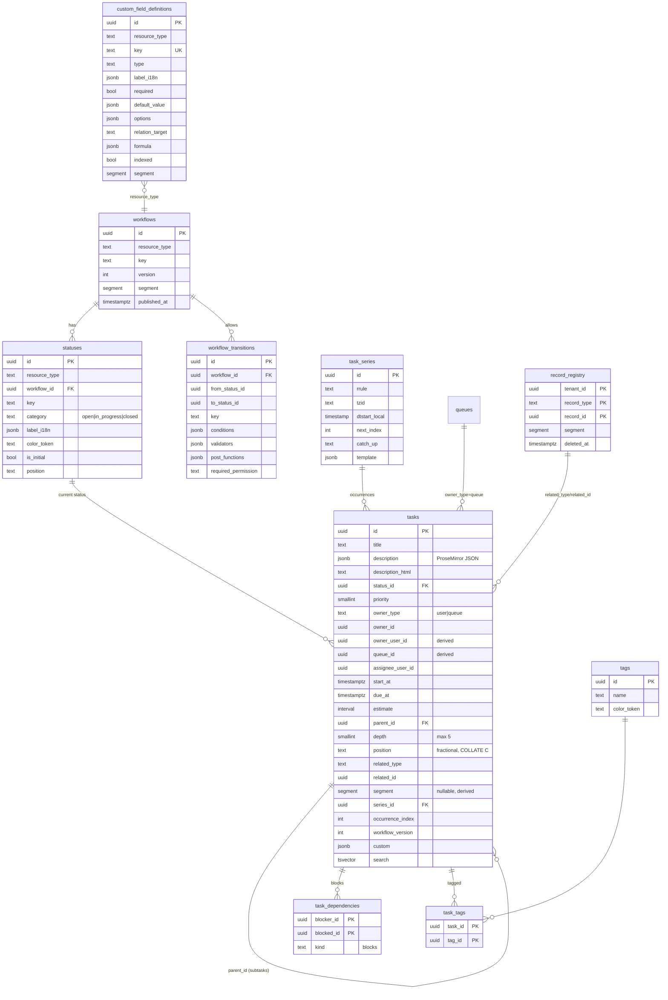

## 4. CRM

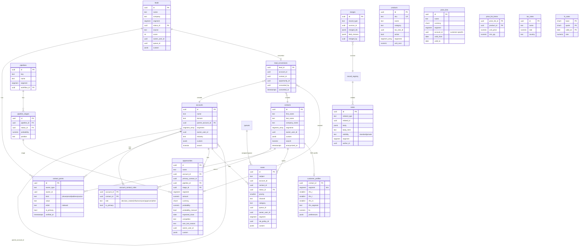

## 5. B2B satış ve ortak satış çekirdeği

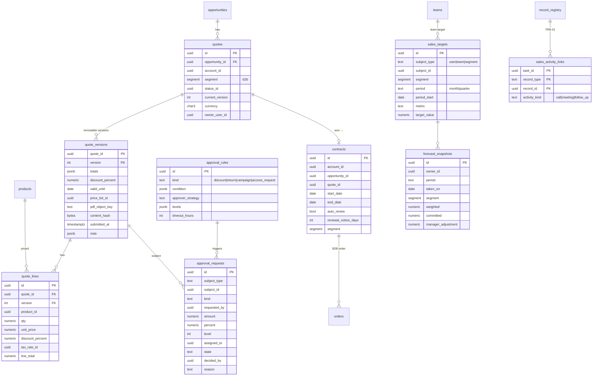

## 6. B2C satış

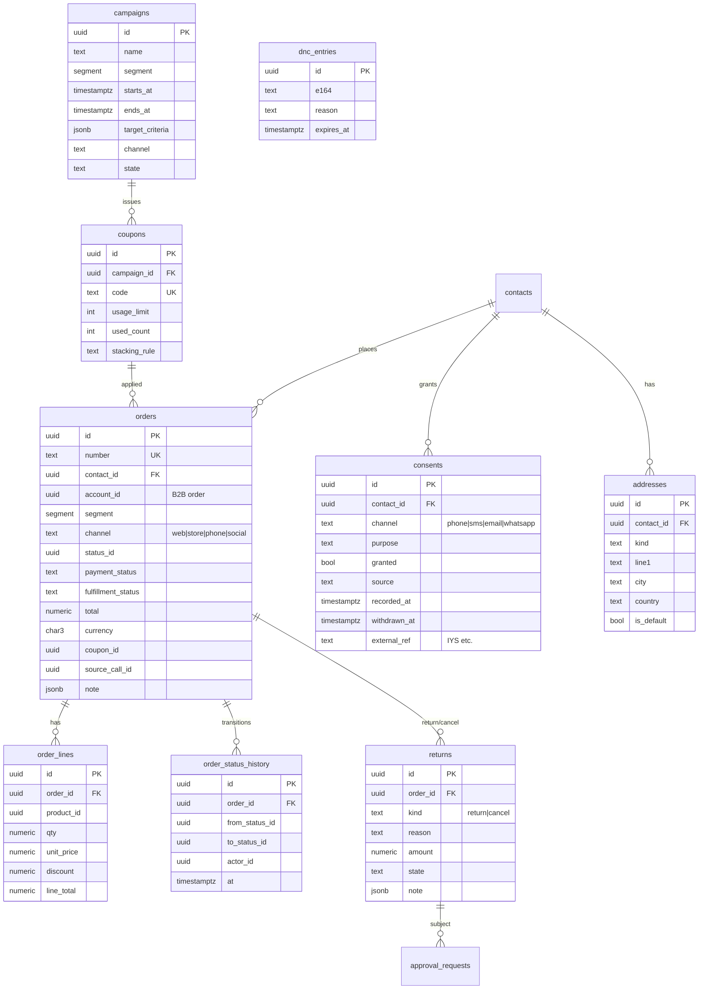

## 7. Çağrı merkezi ve Data Servisi

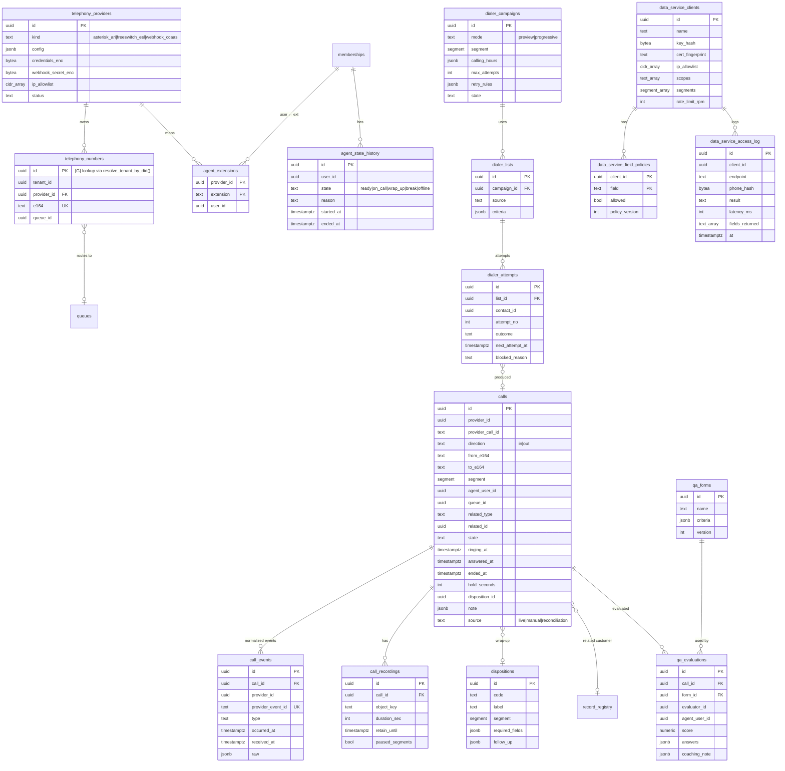

## 8. Timeline, audit, yorum, dosya, mention, bildirim

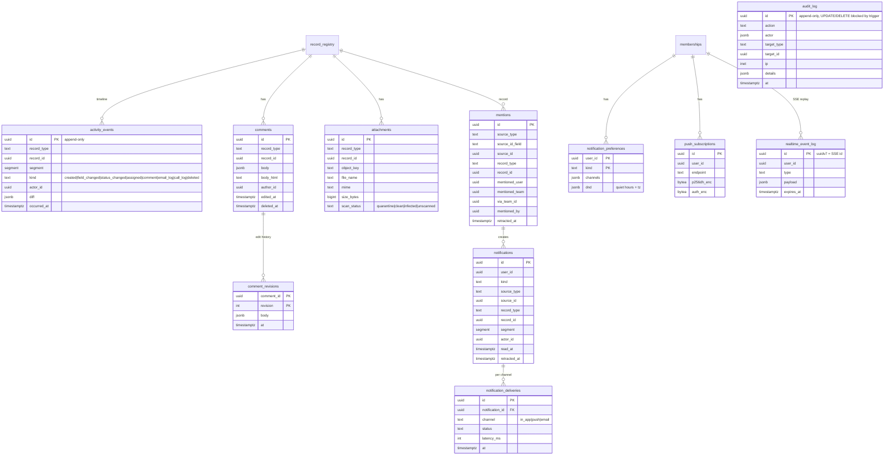

## 9. Otomasyon, SLA, webhook, olay altyapısı

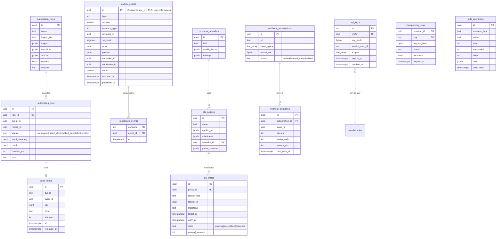

## 10. Yapılandırma, rapor, arama, içe/dışa aktarma

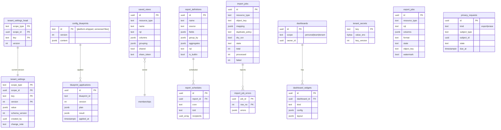

## 11. AI asistan

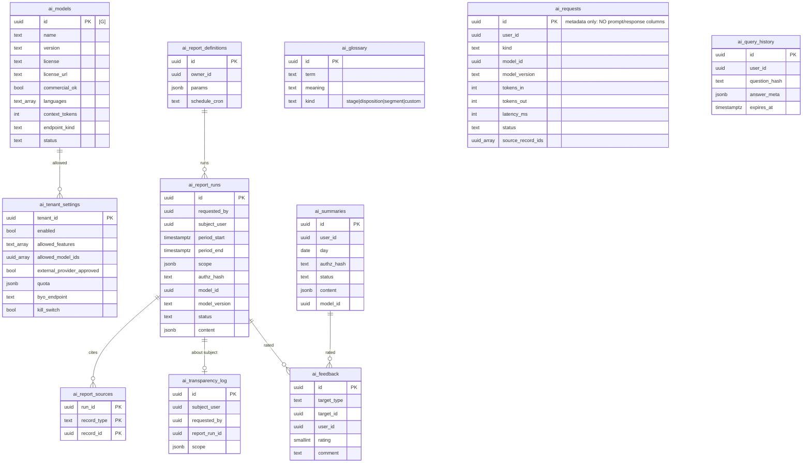

## Bütünlük kuralları özeti

| Kural | Mekanizma |
|---|---|
| Tenant izolasyonu | `tenant_id` + FORCE RLS (RESTRICTIVE) her tenant tablosunda |
| Segment izolasyonu | RESTRICTIVE segment politikası (ADR-0010) |
| Polimorfik bütünlük | `record_registry` bileşik FK, DEFERRABLE |
| Bağımlılık DAG | Servis katmanında DFS + `task_dependencies` yazımında `pg_advisory_xact_lock(tenant)` ile seri hale getirme; ek olarak yinelemeli CTE ile DB kontrolü (trigger) |
| Alt görev derinliği | CHECK `depth <= 5` + trigger ile `parent.depth + 1` |
| Değiştirilemez tablolar | `audit_log`, `activity_events`, gönderilmiş `quote_versions`/`quote_lines`: `BEFORE UPDATE OR DELETE` trigger `RAISE EXCEPTION` + `REVOKE UPDATE, DELETE` |
| Tekrarlayan görev çift üretimi | `UNIQUE (series_id, occurrence_index)` |
| Çağrı olay idempotency | `UNIQUE (tenant_id, provider_id, provider_event_id)`; `UNIQUE (tenant_id, provider_call_id)` |
| Bir hat tek tenant | `telephony_numbers.e164 UNIQUE` |
