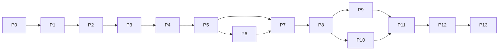

# Bütünleşik Faz Planı

> Faz 0 + G0 · 2026-11-20. Kaynakta iki ayrı yol (Faz 0–8 ve G0–G13) ve iki farklı MVP sırası var. Bu plan onları **tek sıraya** indirger; faz kodları değişmez (izlenebilirlik için). Gerekçe: `requirements-review.md` A1–A4. Onay: `assumptions.md` Q5.
> Kural: bir adım, kabul kriterlerinin tamamı sağlanmadan bitmiş sayılmaz; her adım ayrı oturumda yürütülür; sonunda `docs/progress.md` güncellenir.

## Sıra

| Adım | Kapsam (faz kodları) | Ana çıktı | Neden bu sırada |
|---|---|---|---|
| **P0** ✅ | F0 + G0 (+ G11 çerçevesi) | ADR'ler, ER, API, olaylar, riskler, matris YAML, manifest şeması, token'lar, wireframe'ler | Veri modeli ve yetki modeli baştan doğru kurulmalı |
| **P1** ✅ | F1 + G1-çekirdek | Monorepo, Compose, CI, auth (parola, JWT+refresh, TOTP, OIDC), RLS + DB rolleri, tenant yaşam döngüsü, **modül kayıt defteri ve kapısı**, sızıntı test iskeleti, minimal auth arayüzü | Her şey bunun üzerine kurulur; modül kapısı sonradan eklenirse tüm rotalar elden geçer |
| **P2** ✅ | F2 | Task, status, workflow, custom field, bağımlılık DAG, RRULE, **RQL**, cursor API, outbox yazıcısı (yayın P5'te) | Çekirdek varlık + sorgu dili diğer tüm modüllerce kullanılır |
| **P3** | F3 (segment sütunları dahil) | Lead/Account/Contact/Opportunity/Case, dönüştürme, merge, `contact_points` (E.164), seed | Segment sütunları ilk günden |
| **P4** | F4 + G2 | **Tek yetki motoru** (`can` + predicate), rol hiyerarşisi, OWD, sharing, FLS, segment RLS, Yönetici sınırları, matris API'leri, timeline, yorum, dosya, audit, bildirim temeli; matris tabanlı üretilmiş testler | Tüm yüzeylerin güvenlik temeli |
| **P5** | F5 | Outbox relay, kural motoru, SLA, webhook, API anahtarı, SSE | Bildirim, çağrı ve satış olayları buna dayanır |
| **P6** | F6 (çekirdek) + G9 tasarım sistemi | Token → tema, bileşen kütüphanesi + Storybook, kabuk (modüle duyarlı menü, segment değiştirici, komut paleti), görev görünümleri (liste, Kanban, takvim, Gantt, tablo), kayıt detay, ayar ekranlarının çekirdeği | Görünür ürün; sonraki modüller ekranlarıyla birlikte gelir |
| **P7** | G1-kalan | Yapılandırma motoru (katman, şema, sürüm, diff, geri al), blueprint'ler, marka, plan/kota, gürültülü komşu, SSO (SAML), operatör konsolu, tenant dışa aktarma/silme + **ekranları** | Onboarding sihirbazı için gerekli |
| **P8** | G3 + G6 | Ekip, ürün/fiyat, onay motoru, hedef; mention editörü + anlık bildirim (p95 < 2 sn) + **ekranları** | Satış ve çağrı modüllerinin ortak bağımlılığı |
| **P9** | G4 ve/veya G5 (hedef segmente göre) | B2B (teklif, sözleşme, forecast) / B2C (sipariş, rıza, iade, kampanya, RFM) + ekranları | Q5 yanıtına göre öncelik |
| **P10** | G7 | Telefoni ağ geçidi, simülatör, adaptörler, ekran açma, çağrı kaydı, Data Servisi + ekranları | Çağrı merkezi önceliklendirilirse P9'dan önce |
| **P11** | F7 + G8 | Raporlama, FTS arama, içe/dışa aktarma, i18n tamamlama, Yönetici cockpit, wallboard, dialer, QA | Veri biriktiren modüller hazır |
| **P12** | G11 → G12 → G13 | AI altyapısı (model araştırması + ADR), özet/rapor/sorgu, arayüz + eval/red-team | Kaynağın ön koşulları (G1, G2, G6, G8) sağlanmış olur |
| **P13** | F8 + G10 | Sertleştirme: penetrasyon, yük, kaos, dokümantasyon, demo, sürüm | Son kanıt |

## Bağımlılık grafiği

## Her adımın ortak bitiş tanımı (kaynak §4 DoD + eklemeler)
- Görevler tamam, yeni kod testli, `docker compose up` sıfırdan çalışır, lint/typecheck/test CI'da yeşil.
- Tenant sızıntı paketi (o ana kadar var olan tüm yüzeyler) yeşil.
- `node scripts/contrast-report.mjs`, `scripts/check-permission-matrix.mjs`, `scripts/check-module-catalog.mjs` yeşil (P1'den itibaren CI adımı).
- `docs/progress.md` güncel; o adımda uygulanan gereksinimlerin `requirements-traceability.md`'deki planlanan test ID'leri gerçek test dosyalarında var (CI'da `scripts/check-traceability`, P1'de eklenir).
