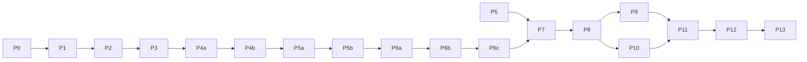

# Bütünleşik Faz Planı

> Faz 0 + G0 · 2026-11-20. Kaynakta iki ayrı yol (Faz 0–8 ve G0–G13) ve iki farklı MVP sırası var. Bu plan onları **tek sıraya** indirger; faz kodları değişmez (izlenebilirlik için). Gerekçe: `requirements-review.md` A1–A4. Onay: `assumptions.md` Q5.
> Kural: bir adım, kabul kriterlerinin tamamı sağlanmadan bitmiş sayılmaz; her adım ayrı oturumda yürütülür; sonunda `docs/progress.md` güncellenir.

## Sıra

| Adım | Kapsam (faz kodları) | Ana çıktı | Neden bu sırada |
|---|---|---|---|
| **P0** ✅ | F0 + G0 (+ G11 çerçevesi) | ADR'ler, ER, API, olaylar, riskler, matris YAML, manifest şeması, token'lar, wireframe'ler | Veri modeli ve yetki modeli baştan doğru kurulmalı |
| **P1** ✅ | F1 + G1-çekirdek | Monorepo, Compose, CI, auth (parola, JWT+refresh, TOTP, OIDC), RLS + DB rolleri, tenant yaşam döngüsü, **modül kayıt defteri ve kapısı**, sızıntı test iskeleti, minimal auth arayüzü | Her şey bunun üzerine kurulur; modül kapısı sonradan eklenirse tüm rotalar elden geçer |
| **P2** ✅ | F2 | Task, status, workflow, custom field, bağımlılık DAG, RRULE, **RQL**, cursor API, outbox yazıcısı (yayın P5'te) | Çekirdek varlık + sorgu dili diğer tüm modüllerce kullanılır |
| **P3** ✅ | F3 (segment sütunları dahil) | Lead/Account/Contact/Opportunity/Case, dönüştürme, merge, `contact_points` (E.164), seed | Segment sütunları ilk günden |
| **P4a** ✅ | F4 + G2 (yetki) | **Tek yetki motoru** (`can` + predicate): kullanıcı segment yetkisi, ekip/kuyruk/hiyerarşi kapsamları, OWD, paylaşım ve kriter kuralları, görev erişiminin parent'tan türetilmesi, FLS, Yönetici sınırları, yönetim API'leri; matristen üretilen testler | Tüm yüzeylerin güvenlik temeli |
| **P4b** ✅ | F4 + G2 (kayıt etrafı) | Activity timeline, yorum + mention, dosya ekleri, e-posta/arama logu, bildirim temeli, audit okuma API'si, delegasyon, yetki talebi, matris düzenleme/diff/sürüm API'leri | Aynı motorun üzerine; `docs/p4-plan.md` §10 |
| **P5a** ✅ | F5 (olay yolu + kurallar) | Outbox + relay + tüketici, kural motoru, idempotency, döngü koruması, retry/DLQ/replay, atama politikaları, kaos testi | Bildirim, çağrı ve satış olayları buna dayanır |
| **P5b** ✅ | F5 (dış dünya) | SLA motoru, webhook'lar, API anahtarları + `Idempotency-Key`, SSE, e-posta özeti | `docs/p5-plan.md` |
| **P6a** ✅ | F6 (çekirdek) + G9 tasarım sistemi | Token → Tailwind teması, bileşen kütüphanesi + Storybook, kabuk (modüle duyarlı menü, tenant/segment değiştirici, rol rozeti, bildirim merkezi, bağlantı göstergesi), komut paleti + kısayollar, görev listesi / Kanban / tablo, görev detayı, geri alma, canlı güncelleme | `docs/p6-plan.md` |
| **P6b** ✅ | F6 (görünümler) | Takvim, Gantt, opportunity pipeline, CRM kayıt listeleri ve detayı, dashboard, kayıtlı görünümler + RQL filtre çubuğu | `docs/p6-plan.md` |
| **P6c** ✅ | F6 (ayarlar) | Workflow editörü, custom field, rol/izin matrisi, otomasyon kural oluşturucu, webhook/API anahtarı, SLA/takvim ekranları; Lighthouse + ekran görüntüsü regresyonu | `docs/p6-plan.md` |
| **P7** ✅ (P7a, P7b, P7c, P7d) | G1-kalan | Yapılandırma motoru (katman, şema, sürüm, diff, geri al), blueprint'ler, marka, plan/kota, gürültülü komşu, SSO (SAML), operatör konsolu, tenant dışa aktarma/silme + **ekranları** | Onboarding sihirbazı için gerekli · dört adım: `docs/p7-plan.md` |
| **P8** ✅ (P8a, P8b, P8c, P8d) | G3 + G6 | Ekip, ürün/fiyat, onay motoru, hedef; mention editörü + anlık bildirim (p95 < 2 sn) + **ekranları** | Satış ve çağrı modüllerinin ortak bağımlılığı · dört adım: `docs/p8-plan.md` |
| **P9** (P9a ✅, P9b ✅, P9c ✅ — G4 bitti) | G4, sonra G5 (Q5: önce B2B) | B2B (teklif, sözleşme, forecast) / B2C (sipariş, rıza, iade, kampanya, RFM) + ekranları | Altı adım: `docs/p9-plan.md` |
| **P10** | G7 | Telefoni ağ geçidi, simülatör, adaptörler, ekran açma, çağrı kaydı, Data Servisi + ekranları | Çağrı merkezi önceliklendirilirse P9'dan önce |
| **P11** | F7 + G8 | Raporlama, FTS arama, içe/dışa aktarma, i18n tamamlama, Yönetici cockpit, wallboard, dialer, QA | Veri biriktiren modüller hazır |
| **P12** | G11 → G12 → G13 | AI altyapısı (model araştırması + ADR), özet/rapor/sorgu, arayüz + eval/red-team | Kaynağın ön koşulları (G1, G2, G6, G8) sağlanmış olur |
| **P13** | F8 + G10 | Sertleştirme: penetrasyon, yük, kaos, dokümantasyon, demo, sürüm | Son kanıt |

## Bağımlılık grafiği

## Her adımın ortak bitiş tanımı (kaynak §4 DoD + eklemeler)
- Görevler tamam, yeni kod testli, `docker compose up` sıfırdan çalışır, lint/typecheck/test CI'da yeşil.
- Tenant sızıntı paketi (o ana kadar var olan tüm yüzeyler) yeşil.
- `node scripts/contrast-report.mjs`, `scripts/check-permission-matrix.mjs`, `scripts/check-module-catalog.mjs` yeşil (P1'den itibaren CI adımı).
- `docs/progress.md` güncel; o adımda uygulanan gereksinimlerin `requirements-traceability.md`'deki planlanan test ID'leri gerçek test dosyalarında var (CI'da `scripts/check-traceability`, P1'de eklenir).
